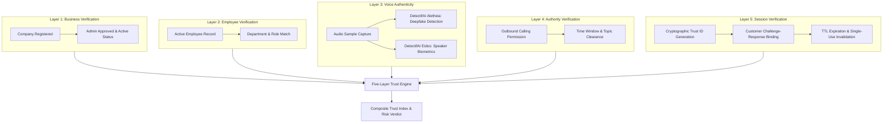
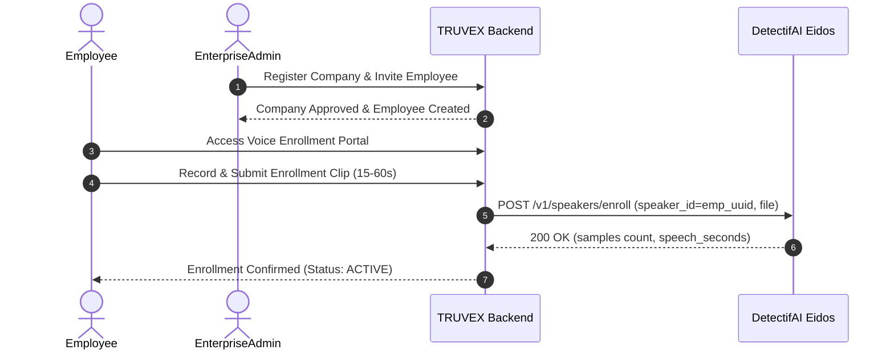
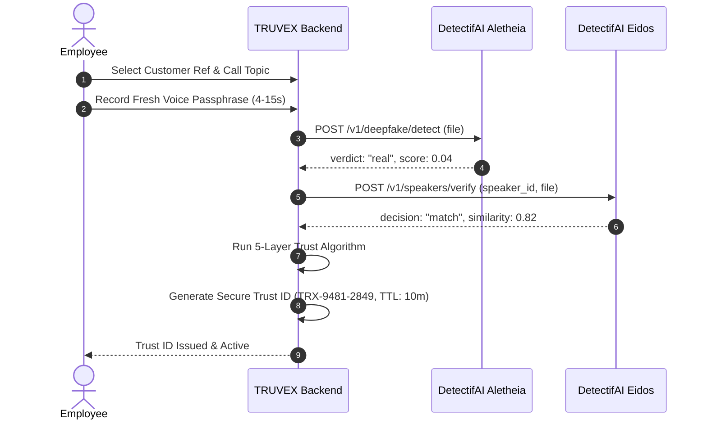
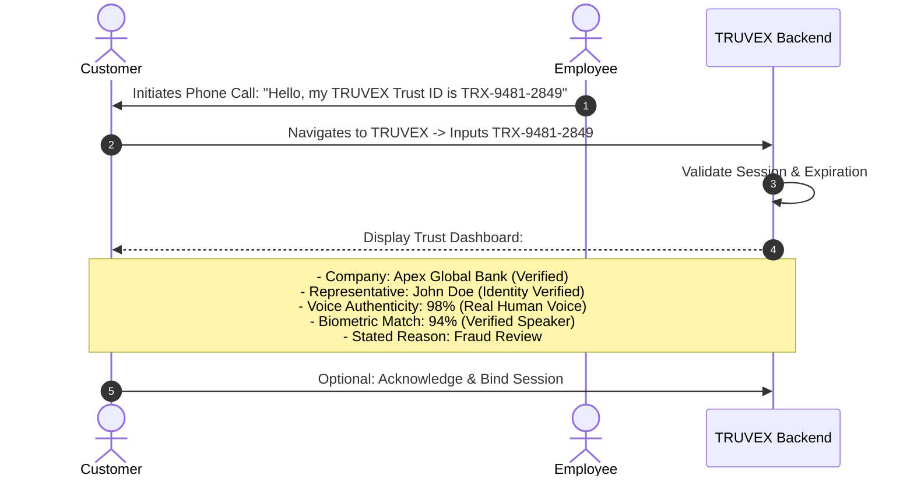

# TRUVEX Architecture Blueprint
**AI-Powered Universal Trust Infrastructure**  
*Tagline: Verify. Connect. Trust.*  
*Hackathon Track: The Trust Layer (Track 03) — CMRIT × DetectifAI*

---

## 1. Executive Summary & Problem Space

### 1.1 The Vulnerability
Modern enterprise-to-customer communication is suffering a catastrophic collapse of trust. Impersonation fraud, synthetic voice cloning, and caller ID spoofing cost consumers and institutions billions annually:
- **Bank Impersonation**: Attackers clone executive or fraud department voices to authorize urgent wire transfers or demand one-time passcodes (OTPs).
- **Recruitment Scams**: Fraudsters pose as corporate recruiters issuing false offers and extracting identity credentials.
- **Support Impersonation**: Fake technical or customer service agents deceive users into granting remote computer access.

Traditional caller ID and telephony mechanisms authenticate neither the caller's true employer, their authority to conduct the conversation, nor the biological authenticity of their vocal tract.

### 1.2 The TRUVEX Solution
TRUVEX establishes an independent, out-of-band **Trust Infrastructure (B2B2C)**. Before an authorized enterprise representative reaches out to a customer, TRUVEX verifies their corporate standing, employee permissions, voice biometrics, and deepfake signals, generating an ephemeral, single-use **Trust ID**. The customer independently validates this Trust ID on the TRUVEX portal or widget to inspect verifiable cryptographic proof of communication authority.

---

## 2. The Five-Layer Trust Engine

TRUVEX calculates a comprehensive **Trust Index (0–100%)** across five independent verification boundaries:



### Layer 1: Business Verification (Weight: 20%)
- Ensures the originating enterprise is vetted and currently in good standing.
- Admin approval gate prevents fraudulent business registrations.
- Fictional business identities are enforced in staging/hackathon environments.

### Layer 2: Employee Identity Verification (Weight: 20%)
- Confirms the employee exists in the active corporate directory.
- Verifies that the employee's status is not suspended, terminated, or under security review.

### Layer 3: Voice Authenticity & Biometrics (Weight: 30%)
- **DetectifAI Aletheia (`/v1/deepfake/detect`)**: Evaluates whether the fresh voice sample shows synthetic artifacts, neural vocoder anomalies, or generative audio signatures. Returns `verdict` (`real` or `fake`) and `score` (0.0 to 1.0).
- **DetectifAI Eidos (`/v1/speakers/verify`)**: Matches the voiceprint against the employee's enrolled voice profile (`speaker_id`), returning `decision` (`match` or `no_match`) and acoustic `similarity` (-1.0 to 1.0).

### Layer 4: Communication Authority Verification (Weight: 15%)
- Assesses whether the employee has explicit administrative authorization to initiate customer contact for the designated topic (e.g., "Account Security Alert", "Loan Verification", "Billing").
- Enforces corporate operating hours and maximum daily session allowances.

### Layer 5: Session & Challenge Verification (Weight: 15%)
- Generates an ephemeral alphanumeric token (`TRX-XXXX-XXXX`) with a 5-to-10-minute validity window.
- When the customer validates the Trust ID, an optional interactive challenge code or verification confirmation establishes mutual session binding.

---

## 3. System Architecture & Components

```text
+-----------------------------------------------------------------------------------+
|                                 CLIENT TIER                                       |
|  +--------------------+   +---------------------+   +--------------------------+  |
|  |   Customer Portal  |   |   Employee Portal   |   |   Admin & Enterprise     |  |
|  | (Trust ID Lookup & |   | (Voice Verification |   |   (Company Onboarding &  |  |
|  |   Fraud Reporting) |   |   & Session Start)  |   |    Policy Management)    |  |
|  +--------------------+   +---------------------+   +--------------------------+  |
+------------------------------------------+----------------------------------------+
                                           | HTTPS / JSON / Multipart
                                           v
+-----------------------------------------------------------------------------------+
|                              FASTAPI BACKEND TIER                                 |
|  +-----------------------------------------------------------------------------+  |
|  | Routes: /api/auth | /api/companies | /api/employees | /api/sessions | ...   |  |
|  +-----------------------------------------------------------------------------+  |
|  | Services:                                                                   |  |
|  |  +---------------------+   +---------------------+   +-------------------+  |  |
|  |  |  aletheia.py        |   |  eidos.py           |   |  trust_engine.py  |  |  |
|  |  | (Deepfake Analysis) |   | (Speaker Match)     |   | (5-Layer Scorer)  |  |  |
|  |  +---------------------+   +---------------------+   +-------------------+  |  |
|  +-----------------------------------------------------------------------------+  |
|  | Database Layer: SQLAlchemy ORM + SQLite (truvex.db)                         |  |
+------------------------------------------+----------------------------------------+
                                           | HTTPS / Authorization: Bearer
                                           v
+-----------------------------------------------------------------------------------+
|                              DETECTIFAI CLOUD API                                 |
|  +-------------------------------------+   +-----------------------------------+  |
|  | Aletheia: /v1/deepfake/detect       |   | Eidos: /v1/speakers/enroll        |  |
|  | (Is this voice real or synthetic?)  |   | Eidos: /v1/speakers/verify        |  |
+-----------------------------------------------------------------------------------+
```

---

## 4. End-to-End Sequence Workflows

### 4.1 Enterprise & Employee Voice Enrollment


### 4.2 Pre-Call Verification & Trust ID Issuance


### 4.3 Customer Independent Verification


---

## 5. Security & Threat Modeling

| Threat Vector | Mitigation in TRUVEX |
| :--- | :--- |
| **Synthetic Voice Impersonation** | DetectifAI Aletheia analyzes micro-acoustic spectral artifacts to catch neural TTS and voice conversion tools. |
| **Replay Attacks** | Employees must speak a dynamic daily phrase or randomized prompt; session recordings are hashed and verified once. |
| **Trust ID Brute-Forcing** | High-entropy random IDs with strict IP rate limiting (5 attempts/min) and short 10-minute TTL. |
| **Compromised Employee Account** | Even if credentials leak, an attacker cannot generate a Trust ID without passing Eidos biometric speaker verification. |
| **Carrier / Telco Blindness** | Independent out-of-band verification decouples authenticity from vulnerable cellular signaling (SS7 / caller ID spoofing). |
